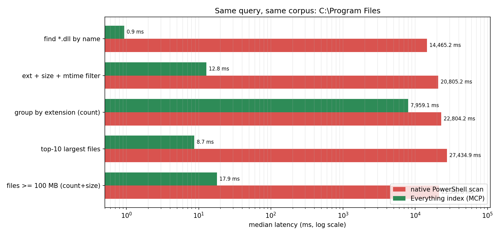
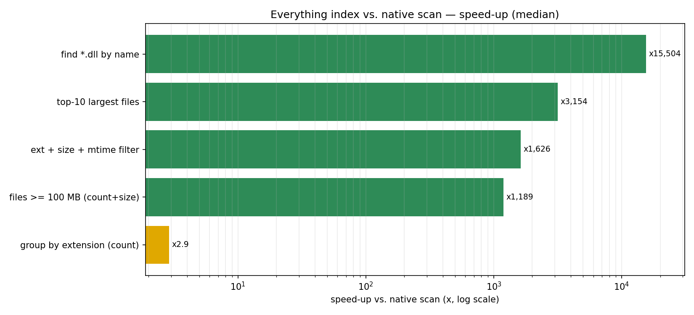
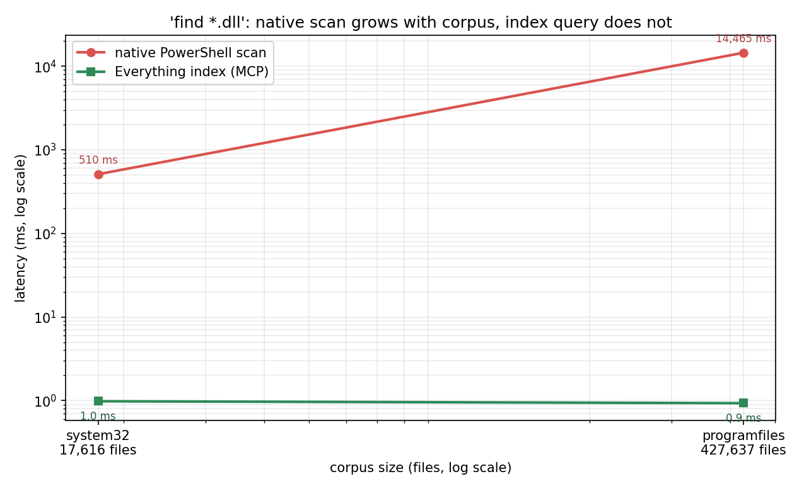

# dsh_everything

[English](README.md) | **简体中文**

> **为 AI Agent 提供 Windows 上的毫秒级文件搜索。** `dsh_everything` 把本机
> [voidtools Everything](https://www.voidtools.com/) 的索引封装成
> [MCP](https://modelcontextprotocol.io/) stdio 服务器，让 Agent 直接在上百万条
> 索引记录中查找、过滤、聚合文件，而不是递归扫描磁盘。


**13 个工具**（7 个查询工具 + 6 个组合工具）· **3 个 MCP 资源** ·
**不需要 `es.exe`、不需要 Everything SDK，除官方 `mcp` SDK 外无第三方 Python 依赖** ·
**仅回环地址**、**默认只读**。

**当前版本：2.0.0** —— 见 [CHANGELOG.md](CHANGELOG.md)。

- [使用手册 / 任务手册](docs/USAGE.zh-CN.md) — 面向任务的精确调用示例
- [能力矩阵](docs/CAPABILITIES.md) — 每条支持/不支持的 Everything 查询，均在 1.4.1.1024 上实测
- [示例配置](examples/) — DSH profile patch、通用 MCP 配置、自定义预设
- [基准测试](benchmarks/) — 可复现的原生 vs 索引测试框架、图表与完整结果

---

## 目录

1. [为什么需要它](#1-为什么需要它)
2. [功能特性](#2-功能特性)
3. [环境要求](#3-环境要求)
4. [安装](#4-安装)
5. [快速开始](#5-快速开始)
6. [工具参考](#6-工具参考)
7. [Everything 查询语法速查](#7-everything-查询语法速查)
8. [常见任务配方](#8-常见任务配方)
9. [基准测试](#9-基准测试)
10. [架构](#10-架构)
11. [安全与隐私](#11-安全与隐私)
12. [已知限制](#12-已知限制)
13. [故障排查](#13-故障排查)
14. [开发与测试](#14-开发与测试)
15. [许可证与致谢](#15-许可证与致谢)

- [更新日志](CHANGELOG.md)

---

## 1. 为什么需要它

Agent 需要找一个文件时，通常只有两个糟糕的选择：

- **递归扫描。** `Get-ChildItem -Recurse`、`os.walk`、`find` —— 每次调用都要遍历
  所有目录、重新预热磁盘缓存，在真实工作站上往往要几秒到几分钟。在几十万文件的
  语料上，一次**热** PowerShell 扫描已经要 16–27 秒，冷启动更糟。Agent 如果在循环里做
  这件事，时间和工具调用预算都花在 I/O 上，而不是推理上。
- **猜。** 问用户文件在哪，或者猜一个路径然后失败。

Everything 维护一份常驻的 NTFS 索引（基于 USN journal），记录文件名、路径、大小和
修改时间。对这份索引查询，即使有上百万条目也能在个位数毫秒内返回，无需遍历磁盘、
无需预热缓存。`dsh_everything` 把这份索引封装在 MCP 服务器后面，Agent 可以直接使用。

它能解锁的具体 Agent 任务：

- *“找到 Q3 预算表并总结一下”* —— `everything_search` 按名称片段、最新优先，
  毫秒级返回。
- *“这个仓库本周改了什么？”* —— `everything_changes`，`since=7d`。
- *“磁盘为什么满了？”* —— `everything_summary` 按扩展名聚合，再取最大的 N 个文件。
- *“有重复照片吗？”* —— `everything_duplicates` 的 `name_size` 或 `hash` 模式。
- *“后端哪里提到了 `TODO`？”* —— `everything_grep` 在候选目录上跑 ripgrep。
- *“把所有超过 10MB 的构建日志导出成 CSV”* —— `everything_export`。

这个服务器不替代 `read`/`edit`/shell 工具，它替代的是这些工具前面的**搜索**步骤 ——
而那通常正是慢的部分。

## 2. 功能特性

- **面向 Agent 设计的 13 个工具**：
  - **7 个查询工具** —— `everything_search`、`everything_count`、
    `everything_status`、`everything_help`、`everything_presets`、
    `everything_export`、`everything_download`。
  - **6 个组合工具** —— `everything_summary`、`everything_duplicates`、
    `everything_grep`、`everything_batch_stat`、`everything_changes`、
    `everything_reveal`。
- **3 个 MCP 资源** —— `everything://help/syntax`、`everything://status`、
  `everything://presets`。
- **Everything 原生查询语法** —— `ext:`、`size:`、`dm:`、`path:`、`parent:`、
  `wfn:`、通配符、`|`（OR）、`!`（NOT）、正则、引号短语、中文文件名。
- **分页、排序、字段裁剪与 `count_only`**，把响应控制在模型上下文窗口能承受的范围内。
- **聚合与重复检测**带硬性扫描上限，任何查询都不可能把整块磁盘倒进上下文。
- **经 ripgrep 的内容搜索** —— 自动探测（`EV_RG_EXE` → DSH 自带 `rg.exe` →
  `PATH` → 常见安装位置）；找不到时返回可操作的错误，而不是崩溃。
- **导出** CSV（UTF-8 BOM，Excel 可直接打开）、JSONL、EFU；**下载**文件走
  Everything HTTP 服务器。两者都限制在配置的根目录内。
- **8 个内置预设**（`recent_modified_7d`、`today_changed`、`large_files_100mb`、
  `screenshots_7d`、`archives_100mb`、`git_repos`、`node_modules`、
  `downloads_today`），并可通过 `EV_PRESETS_FILE` 添加自定义预设。
- **仅回环、无遥测、无外联。** 唯一的网络流量是本机到 `127.0.0.1:8090` 的 HTTP。
- **默认只读。** 只有 `everything_export` 与 `everything_download` 会写文件（且限于
  各自根目录）；`everything_reveal` 是唯一的副作用工具，可用
  `EV_ALLOW_SIDE_EFFECTS=0` 关闭。
- **自动拉起** —— Everything 未运行时，服务器可以最小化启动它
  （`EV_AUTO_START=1`，默认开启）。
- **运行诊断** —— `everything_status` 与 `everything_help` 会解释索引、HTTP 通道、
  ini 开关、ripgrep 与查询能力，而不是静默失败。
- **兼容任意 MCP 客户端。** 主要目标是 DSH（工具名 `mcp__everything__*`），
  但传输层就是标准 MCP stdio。

## 3. 环境要求

| 要求 | 说明 |
|---|---|
| 操作系统 | Windows 10 或 11，文件位于 **NTFS** 卷。Everything 索引 NTFS；FAT/exFAT 与网络共享默认不被索引，除非你手动添加。 |
| Everything | [voidtools Everything](https://www.voidtools.com/) **1.4.1 或更新**，已安装并正在运行。已在 **1.4.1.1024** 上验证；1.5 预期可用，但能力矩阵尚未在 1.5 上重新验证。 |
| Everything HTTP Server | 已启用并绑定到 **`127.0.0.1:8090`**（见[安装](#4-安装)）。 |
| Python | **3.10+**（在 3.11.7 上实测），安装官方 `mcp` SDK **≥ 1.2.0**。 |
| MCP 客户端 | 推荐 DSH（DeepSeek Harness）；任意 MCP stdio 客户端均可。 |
| ripgrep | 可选，仅 `everything_grep` 需要。自动探测；找不到时见[故障排查](#13-故障排查)。 |
| 权限 | 不需要。无需管理员权限，不改系统服务，不在配置根目录外写文件。 |

## 4. 安装

### 4.1 启用 Everything 内置 HTTP Server

服务器通过 Everything 内置的 HTTP JSON API 查询。该功能**默认关闭**，而且 Everything
的 HTTP 接口**没有认证**，因此必须只监听回环地址。

1. **完全退出 Everything**（托盘图标 → *Exit*）。在它运行时改 ini 不会生效：
   Everything 退出时会用自己的内存配置覆盖文件。
2. 用文本编辑器打开 `%APPDATA%\Everything\Everything.ini`。如果该位置没有文件，
   检查 `C:\Program Files\Everything\Everything.ini` —— 其中 `app_data=1` 会把配置
   重定向到 `%APPDATA%`。
3. 只设置以下键（其余保持不变）：

   ```ini
   http_server_enabled=1
   http_server_port=8090
   http_server_bindings=127.0.0.1
   http_server_allow_file_download=1
   ```

4. 重新启动 Everything。
5. 在终端验证：

   ```powershell
   curl.exe "http://127.0.0.1:8090/?search=test&count=1&json=1"
   ```

   正常时会返回 JSON，例如 `{"totalResults":123,"results":[...]}`。此时索引为空也没
   关系，只要返回 JSON 就说明 HTTP 通道已通。

> **绑定项的坑。** `http_server_bindings` 只接受**裸 IP 地址**（`127.0.0.1`）。
> 写成 `127.0.0.1:8090` 会让 Everything **静默地不启动** HTTP 服务器 —— 没有报错、
> 没有监听。端口由独立的 `http_server_port` 键指定。绝不要绑定 `0.0.0.0` 或局域网
> 地址：那会把完整文件列表和文件下载能力无认证地暴露到网络上。

`http_server_allow_file_download=1` 仅 `everything_download` 需要。开启后，本机任意
进程都可以通过回环 HTTP 读取任何已索引文件 —— 这正是该工具的用途，但这是一个需要
你主动做出的本地信任决定。

<details>
<summary>自动化方案：<code>scripts\setup.ps1</code></summary>

仓库自带一个只读环境体检脚本，检查 Everything、HTTP 端点、Python 与 MCP SDK，
并打印带本机真实路径的 DSH profile 片段：

```powershell
pwsh -File scripts\setup.ps1
```

加 `-EnableHttpServer` 可以让它停止 Everything、备份 ini、写入三个 HTTP 键
（`enabled`、`port`、`bindings`）并重启 Everything。它**不会**设置
`http_server_allow_file_download`；如需 `everything_download`，请手动添加该键。

</details>

### 4.2 克隆与安装

推荐：可编辑安装。它会把 `mcp` 依赖装好，并提供 `dsh-everything-mcp` 命令行入口：

```powershell
git clone https://github.com/CZM1998/dsh_everything.git
cd dsh_everything
python -m pip install -e .
```

之后两种入口都可用：

```powershell
dsh-everything-mcp          # 已安装的命令行入口
python -m everything_mcp    # 已安装的模块入口
```

**零安装方案** —— 不做打包安装，只装唯一的依赖，直接跑仓库里的脚本：

```powershell
git clone https://github.com/CZM1998/dsh_everything.git
cd dsh_everything
python -m pip install "mcp>=1.2.0"
python server.py            # 或：python <PATH-TO-REPO>\server.py，任意 cwd 均可
```

服务器通过 stdio 讲 MCP。手动启动时它会等待客户端握手，这是正常的。启动时会做一次
只读自检（探测 HTTP 端点），结果写入 **stderr**（stdout 留给 MCP 协议）。自检失败
不会让进程退出 —— 首次工具调用会重试并返回可操作的指引。

### 4.3 注册到 DSH

DSH 通过 `@deepseek-ai/dsh-mcp-client` 挂载 MCP 服务器。把条目加入目标 profile 的
patch 文件：

```text
%USERPROFILE%\.dsh\profiles\web\cordis.patch.yml
```

patch 文件是一个**顶层 YAML 数组**（loader 条目列表）；把下面的条目合并进现有数组。
替换三个占位符（`<PYTHON>`、`<PATH-TO-REPO>`、`<WORKSPACE>`）；带完整注释的版本见
[`examples/cordis.patch.yml`](examples/cordis.patch.yml)。

```yaml
- id: mcp-everything
  name: "@deepseek-ai/dsh-mcp-client"
  config:
    serverName: everything                 # 工具名显示为 mcp__everything__*
    transport: stdio
    command: <PYTHON>                      # 例如 C:\Python311\python.exe
    args:
      - <PATH-TO-REPO>\server.py           # 例如 D:\work\dsh_everything\server.py
    cwd: <WORKSPACE>                       # 例如 D:\work
    env:
      EV_HTTP_HOST: "127.0.0.1"
      EV_HTTP_PORT: "8090"                 # 必须与 http_server_port 一致
      EV_AUTO_START: "1"
      EV_WORKSPACE_ROOT: "<WORKSPACE>"
      EV_EXPORT_ROOT: "<WORKSPACE>"
      EV_DOWNLOAD_ROOT: "<WORKSPACE>"
      PYTHONUTF8: "1"
      PYTHONIOENCODING: "utf-8"
    toolCallTimeoutMs: 30000
    failOnStartupError: false
```

说明：

- 如果你做了可编辑安装，可以把 `command` 写成 `dsh-everything-mcp` 并省略 `args`，
  不必指向 `server.py`。
- `serverName: everything` 决定了工具前缀 `mcp__everything__<tool>`。
- `EV_WORKSPACE_ROOT` 是 Agent 的工作目录，也是导出/下载根目录的默认父目录。
  除非你确实想把导出放到别处，否则保持三者一致。
- 保持 `failOnStartupError: false`，这样即使 MCP 条目配置错误也不会阻止 harness 启动。
- DSH 会从子进程环境中清洗 `DSH_*` 和形似密钥的变量；`EV_*` 会原样传递。
- 其他 MCP 客户端：改用 [`examples/mcp.json`](examples/mcp.json)。

### 4.4 重启 `dsh web`

Profile 改动在启动时生效。编辑 patch 后请重启 `dsh web`。

> **已知问题：热改 profile。** 如果编辑 profile 时已有会话在运行，运行中的 harness
> 可能持有过期 fiber，之后每次工具调用都会失败并报
> `cannot get required service "sessionProjections" in inactive context`。
> 重启 `dsh web` 即可恢复。推荐流程始终是：编辑 profile → 重启。

### 4.5 验证

让 Agent 先调用 `mcp__everything__everything_status`，再调用
`mcp__everything__everything_search`：

```json
{"query": "ext:py", "max_results": 3}
```

`everything_status` 会返回 `ok: true`、Everything 版本、索引条目数与 HTTP 端点状态。
如果报告异常，按其中的 `hints` 数组或[故障排查](#13-故障排查)表处理。

### 4.6 环境变量

所有配置都通过环境变量完成，每个变量都有可用默认值；只改你需要的即可。

| 变量 | 默认值 | 说明 |
|---|---|---|
| `EV_HTTP_HOST` | `127.0.0.1` | Everything HTTP Server 主机。保持回环。 |
| `EV_HTTP_PORT` | `8090` | 端口；必须与 `Everything.ini` 的 `http_server_port` 一致。 |
| `EV_HTTP_TIMEOUT` | `2.0` | 单次查询 HTTP 超时（秒）。大页查询或下载建议调到 `5`。 |
| `EV_EVERYTHING_EXE` | 自动探测 | 自动拉起时使用的 `Everything.exe` 路径。 |
| `EV_EVERYTHING_CONFIG` | 空 | 高级：给自动拉起的实例传 `-config <ini>`。通常不设。 |
| `EV_AUTO_START` | `1` | HTTP 不可达且无 Everything 进程时，最小化启动 Everything。 |
| `EV_START_TIMEOUT` | `30` | 等待自动拉起的超时（秒）。 |
| `EV_MAX_RESULTS_CAP` | `1000` | `everything_search.max_results` 的硬上限（产品限制，非 Everything 限制）。 |
| `EV_WORKSPACE_ROOT` | 进程 cwd | 工作区根目录；相对路径的基准。 |
| `EV_EXPORT_ROOT` | 同工作区 | `everything_export` 唯一允许写入的目录树。 |
| `EV_DOWNLOAD_ROOT` | 同工作区 | `everything_download` 唯一允许写入的目录树。 |
| `EV_RG_EXE` | 自动探测 | `everything_grep` 使用的 ripgrep 可执行文件。 |
| `EV_PRESETS_FILE` | 空 | 自定义预设文件（JSON 或 YAML；相对工作区或绝对路径）。 |
| `EV_ALLOW_SIDE_EFFECTS` | `1` | `0` 禁用 `everything_reveal`（只读模式）；每次调用重新读取。 |
| `EV_SCAN_CAP` | `50000` | `everything_summary` / `everything_duplicates` 的扫描行数上限。 |
| `EV_HASH_MAX_BYTES` | `268435456` | 哈希总预算（256 MiB），用于 `duplicates(mode=hash)` / `batch_stat`。 |
| `EV_LOG_LEVEL` | `INFO` | 日志级别；日志只写 stderr。 |
| `EV_SKIP_SELF_CHECK` | 空 | 设为 `1` 跳过启动时的 HTTP 自检。 |

## 5. 快速开始

覆盖大多数 Agent 需求的五次调用。“意图”是用户说的话；JSON 是精确的工具参数对象。

### 5.1 查找文件

*“找到 Q3 预算表，最新的优先。”*

```json
{
  "query": "ext:xlsx \"Q3 budget\"",
  "sort": "date_modified",
  "ascending": false,
  "max_results": 20,
  "fields": ["name", "path", "size", "date_modified"]
}
```

返回最新的匹配工作簿及完整路径。引号强制精确短语；不加引号时两个词是 AND 关系。

### 5.2 按扩展名计数

*“这个项目里有多少 Python 文件？”*

```json
{"query": "ext:py", "path_scope": "D:\\work\\my-app"}
```

返回 `{"total": 1284, ...}`，不返回文件列表 —— 最省 token 的存在性判断。

### 5.3 搜索文件内容

*“后端哪里提到了 TODO？”*

```json
{
  "pattern": "TODO",
  "path_scope": "D:\\work\\my-app",
  "exts": ["py", "ts"],
  "max_results": 50
}
```

返回 `matches[]`（含 `path`、`line`、`column`、`text`）与 ripgrep 统计。这是 ripgrep
在候选目录上的内容搜索，不是 Everything 索引查询。

### 5.4 最大的 N 个文件

*“这台机器上最大的十个 ISO 镜像是什么？”*

```json
{
  "query": "size:>100mb ext:iso",
  "sort": "size",
  "ascending": false,
  "max_results": 10,
  "fields": ["name", "path", "size"]
}
```

`sort=size` 配 `ascending=false` 让最大的排最前。需要精确字节阈值时用无单位数值
（见 §7）。

### 5.5 最近变更

*“我的项目这周改了什么？”*

```json
{"since": "7d", "path_scope": "D:\\work\\my-app", "max_results": 20}
```

按修改时间倒序返回窗口内的文件，并附 `window` 对象说明精确时间边界。日期粒度注意事项
见 §6.12。

## 6. 工具参考

所有工具都返回 JSON 对象。错误以 MCP 工具错误形式抛出，消息可操作。在 DSH 中每个
名字都要加前缀 `mcp__everything__`（例如 `mcp__everything__everything_search`）。

| # | 工具 | 类别 | 作用 | 关键参数 | 返回 |
|---|---|---|---|---|---|
| 1 | `everything_search` | 查询 | 在 Everything 索引中搜索文件/目录，支持分页、排序、字段裁剪 | `query`、`regex`、`path_scope`、`folder_only`、`file_only`、`sort`、`ascending`、`offset`、`max_results`、`fields`、`count_only` | `total`、`returned`、`truncated`、`next_offset`、`results[]`、`warnings[]` |
| 2 | `everything_count` | 查询 | 只返回命中数（最省的存在性判断） | `query`、`regex`、`path_scope`、`folder_only`、`file_only` | `total`、`elapsed_ms` |
| 3 | `everything_status` | 查询 | 诊断 Everything、HTTP、索引、ini 开关、ripgrep、预设、能力矩阵 | — | `ok`、`http`、`everything`、`index`、`index_db`、`index_switches`、`rg`、`presets`、`capabilities`、`hints[]` |
| 4 | `everything_help` | 查询 | 自解释能力矩阵、工具清单、示例与提示 | — | 结构化帮助 + `markdown` 字符串 |
| 5 | `everything_presets` | 查询 | 列出或运行内置/自定义预设查询 | `action`（`list`\|`run`）、`name`、`max_results`、`offset`、`path_scope` | `presets[]` 或完整搜索结果 |
| 6 | `everything_export` | 查询 | 在 `EV_EXPORT_ROOT` 内导出 CSV / JSONL / EFU | `query`、`out_csv`/`out_path`、`format`、`columns`、`offset`、`sort`、`max_results` | `ok`、`path`、`rows`、`bytes`、`total`、`truncated` |
| 7 | `everything_download` | 查询 | 经回环 HTTP 把已索引文件下载到 `EV_DOWNLOAD_ROOT` | `path`、`dest`、`max_bytes` | `ok`、`source`、`saved_path`、`bytes`、`max_bytes` |
| 8 | `everything_summary` | 组合 | 按扩展名/目录/类型/大小区间/月份/父目录分组聚合 | `query`、`path_scope`、`group_by`、`dir_depth`、`top_n`、`max_scan`、`include_folders` | `groups[]`（数量/大小统计）、`totals`、`stats` |
| 9 | `everything_duplicates` | 组合 | 按名称、名称+大小、大小或哈希确认查找重复文件 | `mode`、`query`、`path_scope`、`min_size`、`max_groups`、`max_files`、`hash_algo`、`max_hash_bytes`、`max_paths_per_group`、`max_response_bytes` | `groups[]`、`stats`、`warnings[]` |
| 10 | `everything_grep` | 组合 | 在指定路径或 Everything 候选上做 ripgrep 内容搜索 | `pattern`、`fixed_strings`、`case_sensitive`、`query`、`path_scope`、`exts`、`globs`、`no_ignore`、`max_results`、`max_filesize`、`timeout_ms` | `matches[]`、`stats`、`truncated` |
| 11 | `everything_batch_stat` | 组合 | 一次 stat 最多 200 个路径，可选哈希 | `paths`、`include_hash`、`hash_algo`、`max_hash_bytes` | `items[]`、`exists_count`、`missing_count` |
| 12 | `everything_changes` | 组合 | 列出时间窗内变更的文件 | `since`、`path_scope`、`exts`、`max_results`、`sort`、`ascending` | `items[]`、`window`、`count`、`total`、`warnings[]` |
| 13 | `everything_reveal` | 组合 | 在资源管理器中定位/打开路径（唯一副作用工具） | `path` | `ok`、`opened`、`mode` |

### 6.1 `everything_search`

Everything 原生搜索，支持分页与字段裁剪。`regex=true` 把 query 当正则解释；
`path_scope` 会被组合进 Everything 查询（`path:"..."`）**并**在客户端二次校验
（`regex=true` 时退化为客户端前缀过滤，并返回 `approx`/`warnings`）。`fields` 是
`type/name/path/size/date_modified/extension` 的子集；未请求的列根本不会向
Everything 请求。

```json
{
  "query": "ext:log size:>10mb",
  "sort": "size",
  "ascending": false,
  "max_results": 2,
  "fields": ["name", "path", "size", "date_modified"]
}
```

```json
{
  "query": "ext:log size:>10mb",
  "effective_query": "ext:log size:>10mb",
  "total": 10,
  "returned": 2,
  "truncated": true,
  "next_offset": 2,
  "offset": 0,
  "max_results": 2,
  "sort": "size",
  "ascending": false,
  "results": [
    {"type": "file", "name": "build.log", "path": "D:\\work\\builds\\build.log",
     "size": 53485308, "date_modified": "2025-07-05T06:18:42Z"},
    {"type": "file", "name": "debug.log", "path": "D:\\work\\tools\\debug.log",
     "size": 35820691, "date_modified": "2025-08-30T00:36:35Z"}
  ],
  "warnings": [],
  "elapsed_ms": 4.8,
  "channel": "http"
}
```

分页：把返回的 `next_offset` 作为下一次的 `offset`；`truncated=false` 表示到末页。
`count_only=true` 只返回 `total`（等价 `everything_count`）。`sort` 只接受
`name`、`path`、`size`、`date_modified`；其他值会告警并回退 name 升序。name 排序是
Everything 的**自然排序**，不是码点序 —— 不要断言严格字典序。

### 6.2 `everything_count`

最省的问题：存不存在，有多少个？

```json
{"query": "ext:py", "path_scope": "D:\\work\\my-app"}
```

```json
{"query": "ext:py", "effective_query": "ext:py path:\"D:\\work\\my-app\"",
 "total": 1284, "elapsed_ms": 11.4, "channel": "http", "warnings": []}
```

### 6.3 `everything_status`

无参数。任何不对劲时先调它。

```json
{}
```

响应节选（路径用占位符表示）：

```json
{
  "ok": true,
  "channel": "http",
  "http": {"url": "http://127.0.0.1:8090/", "reachable": true, "error": null},
  "everything": {"running": true, "version": "1.4.1.1024",
                 "exe": "C:\\Program Files\\Everything\\Everything.exe"},
  "index": {"total_items": 3200000, "ready": true},
  "index_db": {"path": "C:\\Users\\<USER>\\AppData\\Local\\Everything\\Everything.db",
               "size_mb": 128.8},
  "index_switches": {"index_size": "1", "index_date_modified": "1",
                     "index_date_created": "0", "index_date_accessed": "0",
                     "index_attributes": "0", "index_folder_size": "0"},
  "rg": {"available": true, "source": "dsh-bundled", "version": "ripgrep 15.0.0"},
  "presets": {"count": 8},
  "capabilities": {"columns": ["path", "size", "date_modified"],
                   "sort": ["name", "path", "size", "date_modified"]},
  "auto_start": true,
  "hints": [],
  "elapsed_ms": 45.2
}
```

`hints[]` 给出可操作建议（例如哪些 ini 索引开关关闭、为什么 `dc:`/`da:`/`attrib:`
查询很慢）。

### 6.4 `everything_help`

无参数。自解释入口：支持语法、不支持语法、慢查询、HTTP 参数矩阵、全部 13 个工具、
示例调用与提示。同样的内容以 markdown 字符串放在 `markdown` 字段，也作为
`everything://help/syntax` 资源提供。不确定某个查询前缀是否可用时先调它。

### 6.5 `everything_presets`

```json
{"action": "list"}
```

```json
{
  "action": "list",
  "count": 8,
  "presets": [
    {"name": "recent_modified_7d", "description": "最近 7 天修改过的文件/目录",
     "query": "dm:last7days", "sort": "date_modified", "ascending": false, "max_results": 100},
    {"name": "large_files_100mb", "query": "size:>100mb", "sort": "size", "ascending": false}
  ],
  "warnings": []
}
```

运行一个预设，可选覆盖分页与范围：

```json
{"action": "run", "name": "screenshots_7d", "max_results": 50}
```

内置：`recent_modified_7d`、`today_changed`、`large_files_100mb`、
`screenshots_7d`、`archives_100mb`、`git_repos`、`node_modules`、
`downloads_today`。用 `EV_PRESETS_FILE` 添加自定义预设（见
[§8.8](#88-自定义预设)）。

### 6.6 `everything_export`

在 `EV_EXPORT_ROOT`（默认工作区）内写文件并返回路径。CSV 是带 BOM 的 UTF-8，Excel
可直接打开；JSONL 每行一个对象；EFU 是 Everything 文件列表
（`Filename,Size,Date Modified`，日期为 FILETIME）。默认 5000 行，硬上限 10000；
可用 `offset` 分段导出。

```json
{
  "query": "ext:log size:>10mb",
  "out_path": "reports/big_logs.csv",
  "format": "csv",
  "max_results": 5000,
  "sort": "size",
  "ascending": false
}
```

```json
{"ok": true, "format": "csv", "path": "D:\\work\\reports\\big_logs.csv",
 "rows": 137, "bytes": 24512, "total": 137, "offset": 0,
 "truncated": false, "elapsed_ms": 19.3, "channel": "http", "warnings": []}
```

相对输出路径相对于 `EV_EXPORT_ROOT` 解析；该根之外的绝对路径会被拒绝。

### 6.7 `everything_download`

通过 Everything HTTP 服务器把已索引文件复制到 `EV_DOWNLOAD_ROOT`（默认工作区）。
`dest` 可选；重名会自动加数字后缀。`max_bytes` 默认 2 GiB，超限会删除半成品。

```json
{"path": "D:\\work\\builds\\release.zip"}
```

```json
{"ok": true, "source": "D:\\work\\builds\\release.zip",
 "saved_path": "D:\\work\\release.zip", "bytes": 33554432,
 "size": 33554432, "max_bytes": 2147483648, "elapsed_ms": 128.7}
```

需要 `http_server_allow_file_download=1`。404 通常意味着文件已移动或索引尚未追上；
重新 search 后再试。

### 6.8 `everything_summary`

对命中结果分组，聚合数量与字节数。`group_by` 取 `ext`、`dir`、`type`、
`size_bucket`、`month`、`parent` 之一。默认只聚合文件（目录大小为 0，会污染统计）；
`include_folders=true` 时额外聚合目录，并返回 `aggregates="files+folders"`。

```json
{
  "query": "",
  "path_scope": "D:\\work\\my-app",
  "group_by": "ext",
  "top_n": 6,
  "max_scan": 2000
}
```

```json
{
  "query": "", "path_scope": "D:\\work\\my-app", "group_by": "ext",
  "total": 33, "scanned": 33, "truncated_scan": false,
  "groups": [
    {"key": "py", "count": 14, "size": 412707, "min_size": 6159, "max_size": 80833, "avg_size": 29479},
    {"key": "md", "count": 4, "size": 86907, "min_size": 15990, "max_size": 28990, "avg_size": 21727}
  ],
  "totals": {"count": 33, "size": 891287, "min": 777, "max": 92218},
  "stats": {"groups_found": 2, "returned_groups": 2, "elapsed_ms": 92.8},
  "warnings": [], "elapsed_ms": 92.8
}
```

扫描受 `max_scan` 与 `EV_SCAN_CAP` 限制；`truncated_scan=true` 表示数字只是下限。
`group_by=dir` 时 `dir_depth`（1–12）控制目录键深度；有 `path_scope` 时键相对于它。

### 6.9 `everything_duplicates`

只读重复检测。模式：

- `name` —— 同名（大小写不敏感）；优先使用 Everything 的 `dupe:`，不可用时回退分页
  扫描并给出警告。
- `name_size` —— 同名且同大小（最安全的快速重复信号）。
- `size` —— 同大小（≥ `min_size`）。
- `hash` —— 对同大小候选做哈希（`md5`/`sha1`/`sha256`/`sha512`/`blake2b`）确认真正
  重复，受 `max_files` 与 `max_hash_bytes` 预算限制。

```json
{"mode": "name_size", "path_scope": "D:\\work\\photos", "min_size": 1048576, "max_groups": 5}
```

```json
{
  "mode": "name_size", "query_used": "dupe:", "total": 4, "scanned": 4,
  "groups": [
    {"key": "photo.jpg|2048", "count": 2, "size": 2048, "path_count": 2,
     "paths": ["D:\\work\\photos\\backup\\photo.jpg", "D:\\work\\photos\\photo.jpg"]}
  ],
  "stats": {"groups_found": 1, "returned_groups": 1, "dupe_support": true,
            "max_paths_per_group": 2, "payload_bytes": 1147},
  "warnings": [], "elapsed_ms": 940.1
}
```

输出按模型上下文预算控制：默认 10 组（上限 50）、每组只回前 2 条路径（上限 50，
完整数量看 `path_count`）、响应体积预算 4 KiB（`max_response_bytes`，`0` 关闭）。
它**绝不删除或修改文件**。`dupe:` 会扫描整个索引，约 200ms —— 比普通查询慢得多，
不要在紧凑循环里反复调用。

### 6.10 `everything_grep`

用 ripgrep 做内容搜索。给出 `path_scope` 或 `query`；给 query 时，服务器会从候选文件
的共同父目录推导最多 8 个搜索根。

```json
{
  "pattern": "def main",
  "path_scope": "D:\\work\\my-app\\backend",
  "exts": ["py"],
  "max_results": 3
}
```

```json
{
  "pattern": "def main", "path_scope": "D:\\work\\my-app\\backend",
  "roots": ["D:\\work\\my-app\\backend"],
  "matches": [{"path": "D:\\work\\my-app\\backend\\server.py", "line": 468,
               "column": 1, "text": "def main() -> None:"}],
  "stats": {"files_searched": 11, "files_matched": 1, "elapsed_ms": 118.7,
            "truncated": false, "timed_out": false, "max_results": 3},
  "truncated": false, "warnings": [], "elapsed_ms": 184.7
}
```

`max_results` ≤ 1000，`max_filesize`（如 `10M`），`timeout_ms` 默认 20000
（100–300000），`no_ignore=true` 忽略 `.gitignore`。ripgrep 缺失时返回错误，列出探测过
的路径与修复方法（`winget install BurntSushi.ripgrep.MSVC` 或设置 `EV_RG_EXE`）；
其他工具不受影响。

### 6.11 `everything_batch_stat`

一次 stat 最多 200 个路径（1–200；超出会截断并告警，重复项自动去重）。支持文件、
目录与不存在的路径；可选哈希是只读的，且有预算限制。

```json
{"paths": ["D:\\work\\my-app\\README.md", "D:\\work\\missing.txt"], "include_hash": true}
```

```json
{
  "items": [
    {"path": "D:\\work\\my-app\\README.md", "exists": true, "type": "file",
     "size": 28990, "date_modified": "2026-10-18T03:05:04Z",
     "date_created": "2026-10-18T02:34:20Z", "mode": "0666", "is_link": false,
     "hash": "9f2c...", "error": null},
    {"path": "D:\\work\\missing.txt", "exists": false, "type": null, "size": null,
     "error": "not found"}
  ],
  "count": 2, "exists_count": 1, "missing_count": 1,
  "include_hash": true, "hash_algo": "md5", "stats": {"elapsed_ms": 1.1, "hashed": 1}
}
```

### 6.12 `everything_changes`

时间窗内变更的文件。`since` 接受 `today`、`24h`、`7d`、`30m`、`last7days` 或 ISO
时间戳（如 `2026-10-17T08:00:00+08:00`）。

```json
{"since": "24h", "path_scope": "D:\\work\\my-app", "exts": ["py", "ts"], "max_results": 3}
```

```json
{
  "since": "24h", "query": "dm:>=2026-10-17", "path_scope": "D:\\work\\my-app",
  "items": [
    {"type": "file", "name": "server.py", "path": "D:\\work\\my-app\\backend\\server.py",
     "size": 18220, "date_modified": "2026-10-18T03:15:07Z", "extension": "py"}
  ],
  "count": 1, "total": 33, "truncated": true,
  "window": {"since": "2026-10-17T03:27:59Z", "until": "2026-10-18T03:27:59Z",
             "spec": "24h", "dm_expression": "dm:>=2026-10-17", "precise": true},
  "warnings": ["<说明 dm: 过滤为日期级、精确时间窗由客户端二次过滤>"]
}
```

之所以有警告：Everything 1.4 不认识 `dm:last1hour` 这类相对语法（返回 0）。服务器
始终把 `since` 换算成绝对 `dm:>=YYYY-MM-DD` 过滤，再在客户端套用精确时间窗。
`total` 是日期级候选数，`count` 是精确窗口内的数量。

### 6.13 `everything_reveal`

唯一的副作用工具：在资源管理器中选中文件，或打开目录。它从不删除、移动、复制或
重命名任何东西。`EV_ALLOW_SIDE_EFFECTS=0` 时不启动任何进程，返回
`{"ok": false, "opened": false, "error": ..., "hint": ...}`；该变量每次调用重新读取，
切换无需重启。

```json
{"path": "D:\\work\\my-app\\README.md"}
```

```json
{"ok": true, "opened": true, "mode": "select",
 "path": "D:\\work\\my-app\\README.md", "warnings": []}
```

### 6.14 MCP 资源

| URI | MIME 类型 | 内容 |
|---|---|---|
| `everything://help/syntax` | `text/markdown` | 能力矩阵 markdown（同 `everything_help.markdown`） |
| `everything://status` | `application/json` | 当前状态 JSON（同 `everything_status`） |
| `everything://presets` | `application/json` | 预设清单 JSON（内置 + `EV_PRESETS_FILE`） |

资源读取失败会返回说明性内容，不会影响工具调用；工具始终可用。

## 7. Everything 查询语法速查

`query` 字符串几乎原样传给 Everything，因此 Everything 自己的语法都适用。下面是经过
验证的 1.4.1 常用子集；带实测命中数的完整矩阵见
[`docs/CAPABILITIES.md`](docs/CAPABILITIES.md)。

### 7.1 名称、路径与过滤

```text
report_2025*              文件名通配符
"Q3 budget"               精确短语（引号）
ext:xlsx                  单个扩展名
ext:py;ts;js              多个扩展名 —— 只能用分号
file:report               只匹配文件
folder:node_modules       只匹配目录
path:"D:\work\my-app"     路径包含（含子目录）
parent:"D:\work\my-app"   指定父目录的直接子项 —— 必须完整路径
wfn:*.exe                 完整文件名匹配
startwith:report          名称前缀
endwith:.log              名称后缀
len:>40                   名称长度
empty:                    空目录
nopath:foo                忽略路径匹配
```

`ext:` 只认分号：`ext:exe,dll` 与 `ext:py*` 都静默返回 0。`parent:` 必须是完整
路径；`parent:software` 返回 0。`path:` 是对完整路径的*包含*匹配，因此也会命中子目录。
路径过滤只能写在**搜索字符串内部**：HTTP 的 `path=` 参数是布尔 match-path 开关而非
过滤器，`filter=` 会被忽略。工具的 `path_scope` 参数会自动把 `path:"..."` 组合进
查询。

### 7.2 逻辑与引号

```text
blender ext:exe           空格 = AND
jpg | png                 | = OR
blender !everything.exe   ! = NOT
```

**没有单词 `OR`** —— 写 `jpg | png`。含空格的短语只能用引号。

### 7.3 size: —— KB 量化的坑

带单位的 `size:` **不是字节精确**。Everything 先把 `kb`/`mb`/`gb` 换算成 KB 数 `U`，
再用 `ceil(size / 1024)` 与 `U` 比较。实际效果：

| 查询 | 真正匹配的范围 |
|---|---|
| `size:1024` / `size:1024b` | 恰好 1024 字节（字节精确） |
| `size:1kb` | 1–1024 字节 |
| `size:<1kb` | 只匹配 0 字节文件 |
| `size:2kb` | 1025–2048 字节 |
| `size:1mb` | 1 047 553–1 048 576 字节 —— **不是**精确 1 MiB |
| `size:1k` / `size:1m`（无 `b`） | 单位被忽略，等价于 `size:1` / `size:1048576` 字节 |
| `size:1024..2048` | 区间，含端点 |
| `size:>100mb` | 大于 100 MB（仍是 KB 量化） |

需要精确字节阈值时用无单位数值或区间：`size:>104857600`、
`size:1047553..1048576`。

### 7.4 日期

```text
dm:today
dm:last7days
dm:>=2026-10-17
dm:2026-10-17..2026-10-18
dm:2026-10
```

`dm:` 是修改时间，默认已建索引。小时级相对写法（`dm:last1hour` 等）在 1.4 返回
**0** —— 用 `everything_changes` 或绝对区间。`dc:`（创建）、`da:`（访问）与
`attrib:` 语法上可用，但默认未建索引，可能耗时**超过 5 秒**；先启用对应索引开关并
重建索引，否则直接别用。

### 7.5 仅 Everything 1.5 支持的前缀

这些在 1.4 返回空，本项目任何地方都不推荐：

```text
distinct:    sort:    run_count:    date_run:
```

未知的 `XYZ:` 前缀会被当成字面文本，而不是报错，所以用了不支持函数的查询会安静地
返回 0。如果某个查询返回 0 但语法“应该”可用，去 `everything_help` 查一下前缀。

### 7.6 其他值得知道的规则

- `sort` 是 HTTP 参数，不是查询语法；只有 `name`、`path`、`size`、`date_modified`
  真正生效，未知值静默回退 name。
- name 排序是 Everything 的**自然排序**（本地化、数字按数值比较），不是 Unicode
  码点序。
- 默认不区分大小写；可在 query 里用 `case:` 或设置 `case_sensitive`。
- 中文路径与文件名经 HTTP 通道以 UTF-8 正常工作。
- 优先用 Everything 原生语法而不是正则：更快、更清晰。不要把 `regex=true` 与
  `ext:`/`path:` 等函数混用。

## 8. 常见任务配方

这些任务面向的完整版本（含 Agent prompt 示例与预期输出形状）见
[`docs/USAGE.zh-CN.md`](docs/USAGE.zh-CN.md)。

### 8.1 先搜索再过滤

*“找出今年修改过、位于 Downloads 下的大安装包。”*

```json
{
  "query": "ext:msi;exe dm:>=2026-01-01 size:>100mb",
  "path_scope": "D:\\work\\Downloads",
  "sort": "size",
  "ascending": false,
  "max_results": 20,
  "fields": ["name", "path", "size", "date_modified"]
}
```

### 8.2 用 ripgrep 搜内容

*“找出所有硬编码 API 地址的地方。”*

```json
{
  "pattern": "https://api\\.example\\.com",
  "path_scope": "D:\\work\\my-app",
  "exts": ["ts", "tsx", "js"],
  "fixed_strings": false,
  "max_results": 100
}
```

### 8.3 重复文件检测

*“这个照片库里有重复文件吗？”*

```json
{"mode": "name_size", "path_scope": "D:\\work\\photos", "min_size": 1048576, "max_groups": 10}
```

需要确定性时升级到 `{"mode": "hash", "hash_algo": "sha256", "max_hash_bytes": 536870912}`。

### 8.4 最近变更

*“我今天动过哪些文件？”*

```json
{"action": "run", "name": "today_changed", "max_results": 50}
```

或限定到某个项目：

```json
{"since": "today", "path_scope": "D:\\work\\my-app", "max_results": 50}
```

### 8.5 大文件审计

*“磁盘空间去哪了？”* 两次调用：先按扩展名聚合，再列出最大文件。

```json
{"query": "", "path_scope": "D:\\", "group_by": "ext", "top_n": 15, "max_scan": 50000}
```

```json
{"query": "size:>500mb", "sort": "size", "ascending": false, "max_results": 20,
 "fields": ["name", "path", "size"]}
```

### 8.6 按扩展名或目录聚类

```json
{"group_by": "ext", "path_scope": "D:\\work\\my-app", "top_n": 20}
```

```json
{"group_by": "dir", "dir_depth": 1, "path_scope": "D:\\work\\my-app", "top_n": 20}
```

`group_by=size_bucket` 给出直方图，`month` 按修改月份分组，`parent` 按直接父目录分组。

### 8.7 导出 CSV

*“把所有超过 10MB 的日志给我，做成表格。”*

```json
{
  "query": "ext:log size:>10mb",
  "out_path": "reports/big_logs.csv",
  "format": "csv",
  "sort": "size",
  "ascending": false,
  "max_results": 5000
}
```

文件落在 `EV_EXPORT_ROOT` 下；`rows`、`bytes`、`truncated` 告诉你是否需要再用
`offset` 导下一段。

### 8.8 自定义预设

把 `EV_PRESETS_FILE` 指向一个 JSON 文件（模板见
[`examples/presets.json`](examples/presets.json)）：

```json
{
  "presets": [
    {
      "name": "recent_downloads_7d",
      "description": "最近 7 天修改过的 Downloads 文件",
      "query": "dm:last7days",
      "path_scope": "{downloads}",
      "sort": "date_modified",
      "ascending": false,
      "max_results": 100,
      "fields": ["name", "path", "size", "date_modified"]
    }
  ]
}
```

然后 `{"action": "run", "name": "recent_downloads_7d"}`。预设按名称覆盖内置预设；
占位符 `{downloads}`、`{userprofile}`、`{workspace}` 在运行时展开。JSON 只用标准库；
YAML 需要 PyYAML。

### 8.9 下载文件

```json
{"path": "D:\\work\\builds\\release.zip", "dest": "artifacts/release.zip", "max_bytes": 104857600}
```

目标解析到 `EV_DOWNLOAD_ROOT` 下；文件超过 `max_bytes` 或目标越出根目录时会干净地
失败。这是通过回环 HTTP 复制字节 —— 不是搜索操作。

## 9. 基准测试







测量时间 2026-10-18，环境 Windows 10 Pro（AMD Ryzen 7 5800H，16 GB 内存）、Everything 1.4.1.1024（3,243,750 条索引）、Python 3.11.7。原生基线：预热的 PowerShell 7.6.6，单个 `-NoProfile` 进程；MCP：工具背后同一函数的进程内调用。取 3 个样本的中位数（`C:\Program Files` 取 2 个），丢弃一次预热；加速比按“原生扫描 ÷ MCP 调用”计算。本次运行使用 `EV_SCAN_CAP=600000`，总耗时 517 秒。

**C:\Windows\System32** —— 17,616 个文件，25,531 条索引

| 场景 | 原生扫描（ms） | MCP（ms） | 加速比 | 命中数一致 |
|---|---:|---:|---:|:---:|
| 名称通配符 | 510 | 1.0 | 519× | no |
| 名称正则 | 812 | 65.7 | 12.4× | yes |
| 类型 + 大小 + 日期过滤 | 796 | 0.8 | 1,034× | no |
| 按扩展名统计字节 | 760 | 346 | 2.2× | no |
| 最大的 N 个文件 | 774 | 0.9 | 885× | yes |
| ≥100MB 文件 | 693 | 1.3 | 514× | no |
| 最近 7 天变更 | 669 | 0.9 | 780× | no |

**C:\Program Files** —— 427,637 个文件，554,843 条索引

| 场景 | 原生扫描（ms） | MCP（ms） | 加速比 | 命中数一致 |
|---|---:|---:|---:|:---:|
| 名称通配符 | 14,465 | 0.9 | 15,504× | no |
| 类型 + 大小 + 日期过滤 | 20,805 | 12.8 | 1,626× | no |
| 按扩展名统计字节 | 22,804 | 7,959 | 2.9× | no |
| 最大的 N 个文件 | 27,435 | 8.7 | 3,154× | yes |
| ≥100MB 文件 | 21,336 | 17.9 | 1,189× | no |

**合成语料（30k 文件 / 200 目录）** —— 30,000 个文件，30,201 条索引

| 场景 | 原生扫描（ms） | MCP（ms） | 加速比 | 命中数一致 |
|---|---:|---:|---:|:---:|
| 名称通配符 | 179 | 1.1 | 162× | yes |
| 名称正则 | 797 | 72.3 | 11.0× | yes |
| 类型 + 大小 + 日期过滤 | 438 | 1.0 | 453× | yes |
| 按扩展名统计字节 | 554 | 526 | 1.1× | yes |
| 最大的 N 个文件 | 724 | 0.9 | 792× | yes |
| ≥100MB 文件 | 412 | 16.1 | 25.6× | yes |
| 重复文件组 | 549 | 560 | 1.0× | yes |
| 最近 7 天变更 | 440 | 15.9 | 27.7× | no |
| 内容 grep | 21,001 | 1,354 | 15.5× | yes |
| 单个小目录 | 3.0 | 0.7 | 4.1× | yes |

MCP 侧是进程内调用，因此这些计时不含 JSON-RPC 传输：独立的端到端 MCP stdio 往返测量的中位数为 5.74 ms —— 需要整次调用延迟时请加上它。分组聚合与重复检测是 MCP 侧最弱的场景（约 1–3 倍），因为它们要通过 HTTP 每次 1000 行地分页扫描索引。200 文件的小目录在绝对时间上接近持平：3.0ms 对 0.7ms。

**为什么计数不同。** 标记为 `no` 的行是合理差异而非错误：（a）受 ACL 保护的子树（如 `C:\Windows\System32\config\systemprofile` 与 `C:\Program Files\WindowsApps`）会被 Everything 索引，但普通用户权限的递归扫描无法枚举—— 这是最大的差异，方向是*索引计数更高*；（b）Windows 系统目录不断变化，部分索引条目会滞后于磁盘；（c）Everything 的 `dm:` 过滤是日期粒度，而原生基线使用精确的“当前时间 − 7×24h”窗口；（d）`size:` 单位是 KB 量化。计数仅作参考，不作为正确性判据 —— 真正重要的是查询语义与返回行。

### 9.1 测试方法

基准测试框架位于 [`benchmarks/`](benchmarks/)，可复现：`benchmarks/bench.py` 驱动
两侧对比，`benchmarks/native_baseline.ps1` 是 PowerShell 基线，
`benchmarks/gen_dataset.py` 生成合成语料。

- **同一语料、同一查询、两侧对比。** 每个场景在完全相同的文件集与相同的路径范围上运行：
  一次原生 PowerShell 递归扫描，与等价的 Everything 索引查询。
- **原生基线是预热且地道的 PowerShell 7.6.6。** `Get-ChildItem`、`Where-Object` 与
  `findstr` 在单个 `pwsh -NoProfile` 进程内运行，用 `[Diagnostics.Stopwatch]` 计时。
  排除 shell 启动时间，丢弃一次预热，每个场景取 3 个样本的中位数（`C:\Program Files`
  的 16–27 秒扫描取 2 个样本）。分组使用 O(n) 哈希表而不是 `Group-Object`，因为
  PowerShell 5.1 的 `Group-Object` 在 3 万条数据上要 36 秒 —— 基线是地道的，而不是
  被人为拖慢。这是扫描的*最好情况*。
- **MCP 侧走同一代码路径、在进程内测量。** 每次测量都调用 MCP 工具背后的同一个函数，
  查询与路径范围完全相同；另有独立的端到端 stdio 测量报告 JSON-RPC 开销（参考机器上
  中位数 5.74ms）。
- **校验正确性，而不是假设。** 每个场景都对比原生与 MCP 的命中数；合理的差异（返回上限、
  索引范围、受 ACL 保护的子树、KB 量化的 `size:` 语法、日期粒度的 `dm:`）记录在
  `count_match` / `count_note` 中并在上文解释，而不是隐藏。
- **语料：** `C:\Windows\System32`（小，约 17.6k 文件）、`C:\Program Files`
  （大，约 427.6k 文件），以及生成的合成目录树（30k 文件、200 个目录、已知扩展名/大小/
  修改时间分布、约 350 个与重复检测相关的文件）。完整运行使用 `EV_SCAN_CAP=600000`，
  以便聚合场景能覆盖整个 `C:\Program Files`；其余设置均为默认值。

### 9.2 公平性说明 —— 引用数字前请先读

> **一句话诚实总结：** 这些数字比较的是“查询预建索引”与“现场递归扫描”。它们衡量的
> 是拥有索引带来的价值，而不是什么更快的魔法文件系统。范围很小或缓存已热时，差距会
> 缩小到接近持平；语料很大且重复查询时，差距才显著。Everything 仅支持 Windows/NTFS；
> `everything_grep` 的速度来自 ripgrep 加很小的候选集，而不是索引本身。

- **索引是预建并持续维护的。** Everything 的优势来自它已经遍历过文件系统一次，并通过
  USN journal 跟踪变化。基准测试比较的是“查询这份索引”与“现场扫描”，并没有比较
  “建索引成本”与“扫描成本”。索引的构建与维护成本仍然要有人承担。
- **冷缓存与极小范围会抹平优势。** 如果目标目录的元数据已经在内存中，原生扫描可能只要
  几毫秒；此时 MCP 往返加 HTTP 查询可能持平甚至更慢。加速比随语料规模与重复查询次数
  增长。
- **仅 Windows 与 NTFS。** Everything 无法索引 Linux 文件系统、网络共享（默认）、
  FAT/exFAT 卷，或你没加入索引的卷。这里没有可移植的等价物。
- **内容搜索是 ripgrep，不是 Everything。** `everything_grep` 的速度取决于候选目录树、
  文件大小、忽略规则与 pattern —— 与 Everything 索引无关。但它仍远快于全盘 grep，
  因为候选集很小。
- **聚合与重复检测是 MCP 侧最弱的场景。** `everything_summary` 与
  `everything_duplicates` 通过 HTTP 每页 1000 行分页扫描索引，因此加速比大约只有
  1–3 倍，而不是单次过滤查询那种三位数。它们有界且可预测，但不是索引最擅长的场景。
- **索引的内存与磁盘是真实成本。** Everything 把索引常驻内存并落盘（数百万条目的机器
  上是数百 MB）。基准数字不包含这部分开销。
- **除单独报告的 stdio 往返测量外，每次操作的计时不含工具调用开销**。Agent 每次调用
  都要付这份开销。

## 10. 架构

```text
┌──────────────────────────┐
│ MCP 客户端（DSH / 其他） │
│  mcp__everything__*      │
└────────────┬─────────────┘
             │ MCP stdio（JSON-RPC over stdin/stdout）
┌────────────▼─────────────┐
│ server.py                │  FastMCP 服务器：7 个查询工具 + 3 个资源，
│ everything_mcp/server.py │  并注册 6 个组合工具
└────────────┬─────────────┘
             │
     ┌───────┴────────┐
     │                │
┌────▼─────────┐  ┌───▼──────────────────────────────────────────────┐
│ client.py    │  │ compose_tools.py                                 │
│ search/count │  │ summary · duplicates · grep · batch_stat ·       │
│ status/export│  │ changes · reveal                                 │
│ download     │  │        │                                         │
└────┬─────────┘  │        ├── rg.py → ripgrep（内容搜索）            │
     │            │        └── 本地只读后处理                         │
     │            └───┬──────────────────────────────────────────────┘
┌────▼─────────┐      │
│ http_channel │      │
│ urllib, JSON │      │
└────┬─────────┘      │
     │ HTTP GET http://127.0.0.1:8090/?search=...&json=1
┌────▼─────────────────▼─────┐
│ voidtools Everything       │
│ 内置 HTTP JSON API         │
│ NTFS 索引（USN journal）    │
└────────────────────────────┘
```

一次工具调用的链路：MCP 客户端 → FastMCP 分发 → 工具函数 → `client.py`（参数校验、
查询组合、warnings）→ `http_channel.py`（URL 编码、HTTP、FILETIME/size 归一化）→
Everything。组合工具通过 `client.search` 分页并在本地后处理；`everything_grep`
调用 ripgrep 而不是用 Python 读文件内容。

| 模块 | 职责 |
|---|---|
| `server.py` | 入口；任意 cwd 可用 |
| `everything_mcp/server.py` | FastMCP 实例、7 个查询工具、3 个 MCP 资源、组合工具注册 |
| `everything_mcp/client.py` | 业务层：search/count/status/export/download、`path_scope`、`fields`、warnings、自动拉起 |
| `everything_mcp/http_channel.py` | Everything HTTP 客户端、JSON 解析、FILETIME→ISO 8601、下载 URL 构造 |
| `everything_mcp/compose_tools.py` | 6 个组合工具及其预算/上限 |
| `everything_mcp/rg.py` | ripgrep 探测与内容搜索封装 |
| `everything_mcp/presets.py` | 内置预设、`EV_PRESETS_FILE` 加载与校验 |
| `everything_mcp/help.py` | 能力矩阵常量与 `everything_help` 渲染 |
| `everything_mcp/winipc.py` | 进程/窗口探测与 exe 版本读取（仅诊断，ctypes） |
| `everything_mcp/config.py` | 环境变量配置 |
| `tests/test_mcp.py` | 端到端 MCP 测试套件 |
| `scripts/setup.ps1` | 只读环境体检脚本，可选写 ini |
| `scripts/privacy_check.py` | 发布前个人数据扫描 |
| `benchmarks/` | 原生 vs MCP 基准测试框架、结果与图表 |
| `docs/` | 使用手册与能力矩阵 |
| `examples/` | DSH profile patch、通用 MCP 配置、自定义预设 |

## 11. 安全与隐私

- **仅回环。** 服务器只访问 `http://127.0.0.1:8090/`，从不访问互联网。无遥测、无统计、
  无更新检查。
- **Everything 的 HTTP API 没有认证。** 绑定到 `0.0.0.0` 或局域网地址会把完整文件
  列表与文件下载暴露到网络。务必使用 `http_server_bindings=127.0.0.1`。这是整套配置中
  最重要的安全设置。
- **默认只读。** 搜索、计数、聚合、重复检测、批量 stat、变更列表与 grep 只读。唯一的写
  操作是 `everything_export` 与 `everything_download`，都在路径解析与符号链接检查后
  限制在 `EV_EXPORT_ROOT` / `EV_DOWNLOAD_ROOT` 内；`everything_download` 还强制
  `max_bytes` 并清理半成品。
- **只有一个副作用工具。** `everything_reveal` 会启动资源管理器。需要严格只读时设置
  `EV_ALLOW_SIDE_EFFECTS=0`；该变量每次调用重新读取，无需重启。
- **响应有界。** `EV_MAX_RESULTS_CAP`（1000）、`EV_SCAN_CAP`（5 万）、
  `EV_HASH_MAX_BYTES`（256 MiB）、grep 超时、4 KiB 重复响应预算与 1 万行导出上限，
  确保单次调用不会把整块磁盘塞进模型上下文，也不会把机器拖死。
- **文件内容不会离开本机。** 服务器在本地运行；模型只看到工具返回的 JSON。
- **自动拉起是本地且可见的。** 它只会在没有 Everything 进程且 HTTP 端点不可达时，以
  `Everything.exe -startup` 最小化启动。设 `EV_AUTO_START=0` 可完全自己管理。
- **不涉及任何凭据。** 这里不读取、不存储密钥、令牌或密码。

## 12. 已知限制

- **仅 Windows + NTFS。** 不支持 macOS/Linux；Everything 默认不索引网络共享或
  FAT/exFAT 卷。
- **需要运行中的 Everything 且启用 HTTP Server。** 没有它，工具返回可操作的错误；
  不存在回退扫描器。
- **1.5 尚未验证。** 能力矩阵（支持语法、慢查询、列行为）是在 **1.4.1.1024** 上测的。
  Everything 1.5 调整了部分查询函数；升级后请重跑 `tests/test_mcp.py` 与矩阵命令。
- **`dc:` / `da:` / `attrib:` 默认未建索引**，可能超过 5 秒。启用它们需要改 ini 并
  全量重建索引。
- **1.4 没有小时级相对日期。** `everything_changes` 归一化为日期级 `dm:` 再在客户端
  精确过滤；`total` 是日期级候选数。
- **带单位的 `size:` 是 KB 量化**，不是字节精确（见 §7.3）。
- **内容搜索依赖 ripgrep** 已安装或随附。缺失时 `everything_grep` 会带说明失败，其余
  12 个工具不受影响。
- **`everything_duplicates(mode=name)` 使用 `dupe:`**，会扫描整个索引（320 万条目机器
  上约 200ms），比普通查询慢得多。
- **没有 IPC/ETP 传输。** Everything 1.4 的 IPC 查询协议需要官方 SDK；本项目刻意只
  使用内置 HTTP Server。IPC 窗口探测仅用于判断 Everything 是否在运行。
- **不支持命名 Everything 实例。** `-instance` / `-config` 实例无法使用 Everything
  服务（空索引），因此服务器始终复用默认实例。
- **聚合数字可能是下限。** 触发 `max_scan` / `EV_SCAN_CAP` 时，`truncated_scan` 会
  标记。
- **索引近实时，但不是即时。** 其他进程新建的文件通常 1–5 秒内可见；删除的消失也在
  同一量级。刚写完的文件可能短暂搜不到。

## 13. 故障排查

| 症状 | 可能原因 | 处理 |
|---|---|---|
| `everything_status` 报 HTTP 不可达 | HTTP 未启用、端口不符、绑定写错 | 设置 `http_server_enabled=1`、`http_server_port=8090`、`http_server_bindings=127.0.0.1`，完全重启 Everything |
| HTTP 一直不启动且无报错 | `http_server_bindings` 写成了 `127.0.0.1:8090` | 绑定项只写**裸 IP**；端口是独立的 `http_server_port` 键 |
| 8090 有响应但不是 Everything | 其他程序占用了端口 | `netstat -ano \| findstr :8090` 查 PID；同时修改 `http_server_port` 与 `EV_HTTP_PORT` |
| Everything 正常但查询返回 0 | 索引仍在构建，或查询用了不支持的前缀 | 看 `everything_status.index.total_items`；先用普通名称搜索；在 `everything_help` 核对前缀 |
| `everything_grep` 报找不到 ripgrep | `rg.exe` 不在 `PATH` / DSH 自带缺失 | `winget install BurntSushi.ripgrep.MSVC`，或设置 `EV_RG_EXE`；错误里会列出探测过的路径 |
| `everything_reveal` 返回 `ok=false` | `EV_ALLOW_SIDE_EFFECTS=0` | 设为 `1`（或移除）；无需重启 |
| `everything_download` 返回 404 | 文件已移动/删除、索引过期，或未启用文件下载 | 重新 `everything_search`；确认 `http_server_allow_file_download=1` |
| `everything_download` 报文件过大 | 超过 `max_bytes`（默认 2 GiB） | 调大 `max_bytes` 或换传输方式 |
| 导出/下载被拒：工作区外/下载根之外 | 目标解析到 `EV_EXPORT_ROOT` / `EV_DOWNLOAD_ROOT` 之外 | 改用根目录内的相对路径，或调整环境变量 |
| `size:<1kb` 几乎没结果 | 1.4 的 `size:` 是 KB 量化 | 用无单位字节：`size:<1024` |
| `dc:` / `da:` / `attrib:` 查询超时 | 这些字段未建索引 | 不要用，或启用 ini 开关并重建索引 |
| 中文文件名搜不到 | Everything 版本过旧，或中间层非 UTF-8 | 用本服务器的工具（HTTP 链路 UTF-8）；要求 Everything 1.4+ |
| 命名实例显示空索引 | 命名实例无法使用 Everything 服务 | 使用默认实例 |
| 自动拉起没发生 | `EV_AUTO_START=0`，或找不到 `Everything.exe` | 设 `EV_AUTO_START=1` 和/或 `EV_EVERYTHING_EXE` |
| 改了 profile 后 DSH 每次工具调用都失败 | 热改 profile 留下的过期 fiber | 重启 `dsh web`；错误为 `cannot get required service "sessionProjections" in inactive context` |
| 磁盘繁忙时查询超时 | 索引重建、超大页或大文件下载 | 调大 `EV_HTTP_TIMEOUT`（如 `5`）后重试 |
| `python -m pip install -e .` 失败 | pip 过旧，或 Python < 3.10 | 升级 pip 并使用 Python 3.10+ |

## 14. 开发与测试

```powershell
git clone https://github.com/CZM1998/dsh_everything.git
cd dsh_everything
python -m pip install -e .
python tests\test_mcp.py
```

测试套件是端到端 MCP 测试：通过 stdio 启动服务器（在环境禁止命名管道时自动降级为匿名
管道 / 内存传输），完成 initialize 握手，列出工具与资源，并针对真实本地索引逐个验证
所有工具。

- **142 项断言检查**，在 Everything 正常运行的机器上应全部通过。Tier A 检查（握手、
  注册、status、search/count 结构、导出与越界拒绝、错误端口、两个入口、
  help/status/presets/资源）不依赖索引是否构建完成。
- **Tier B** 最多等待 240 秒索引，超时按跳过而非失败处理（全新安装可能仍在索引）。
- **临时数据**由 Python 在工作区内创建，Everything 几秒内即可索引；测试随后删除并轮询
  `count == 0` 确认索引已回收。不要用“写入后 Everything 不会立即观察到”的工具造测试
  数据再立刻断言索引可见。
- 测试**不会**启动或停止 Everything（测试内 `EV_AUTO_START=0`），也不会修改用户索引。
- 常用测试环境变量：`EV_HTTP_PORT`、`EV_TEST_INDEX_WAIT`、
  `EV_TEST_TRANSPORT=auto|stdio|memory`。

发布改动前运行隐私检查：

```powershell
python scripts\privacy_check.py          # 仅检查 git 已知文件
python scripts\privacy_check.py --all    # 检查整个工作树
```

它会标记真实用户目录路径、邮箱、手机号，以及 `.privacy-blocklist` / `PRIVACY_TERMS`
中的词条。

仓库结构：

```text
dsh_everything/
├── server.py                  # 入口（任意 cwd）
├── everything_mcp/            # 包
│   ├── server.py              # FastMCP 服务器：查询工具 + MCP 资源
│   ├── client.py              # 业务层：search/count/status/export/download
│   ├── http_channel.py        # Everything HTTP 客户端 + 归一化
│   ├── compose_tools.py       # 6 个组合工具
│   ├── rg.py                  # ripgrep 探测 + 内容搜索
│   ├── presets.py             # 内置 + 自定义预设
│   ├── help.py                # 能力矩阵 + 帮助渲染
│   ├── winipc.py              # 进程/窗口诊断（ctypes）
│   └── config.py              # 环境变量配置
├── tests/test_mcp.py          # 端到端 MCP 套件（142 项断言检查）
├── scripts/                   # 环境体检 + 隐私检查
├── docs/                      # 使用手册、能力矩阵
├── examples/                  # profile patch、MCP 配置、预设
├── benchmarks/                # 原生 vs MCP 框架、结果、图表
├── pyproject.toml             # 打包（命令行入口 dsh-everything-mcp）
├── LICENSE                    # MIT
└── README.md / README.zh-CN.md
```

项目除 MCP SDK 外没有第三方运行时依赖，其余只用 Python 标准库；日志写 stderr，绝不
污染 stdio 协议流。欢迎贡献 —— 行为变化时请同步更新能力矩阵与测试。

## 15. 许可证与致谢

MIT —— 见 [LICENSE](LICENSE)。Copyright (c) 2026 CZM1998。

站在这些项目的肩膀上：

- [voidtools Everything](https://www.voidtools.com/) —— 让整套方案成立的索引与
  HTTP API。
- [ripgrep](https://github.com/BurntSushi/ripgrep) —— `everything_grep` 背后的快速
  内容搜索。
- [Model Context Protocol](https://modelcontextprotocol.io/) 与
  [官方 Python SDK](https://github.com/modelcontextprotocol/python-sdk) ——
  传输与服务端框架。
- [DeepSeek Harness](https://github.com/deepseek-ai/dsh) —— 本服务器主要面向的 MCP
  宿主。

Everything 是 voidtools 的商标。本项目与 voidtools 无关联，也未获其背书。
